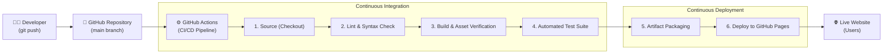

# 📋 To-Do List Application with CI/CD Pipeline

[](https://github.com/nanthakumar20050718-cmyk/todo-list-cicd/actions)
[](LICENSE)
[](https://nanthakumar20050718-cmyk.github.io/todo-list-cicd/)

An automated Continuous Integration and Continuous Deployment (CI/CD) implementation for a responsive **To-Do List Web Application** using **GitHub Actions** and **GitHub Pages**.

---

## 📌 Project Overview
* **Project Name:** Automated Build, Test, and Deployment Using GitHub Actions
* **Domain:** DevOps
* **Project Level:** Beginner
* **Technologies:** HTML5, CSS3, JavaScript (ES6+), Git, GitHub, GitHub Actions, GitHub Pages

This project demonstrates real-world DevOps practices by automating linting, asset validation, unit testing, and zero-downtime deployment on push events to the repository.

---

## 🏗️ Architecture & Pipeline Flow



---

## 🚀 Features

* **Task Management:** Add new tasks, mark tasks as completed, delete tasks, and clear completed tasks.
* **Smart Filtering:** Filter tasks by *All*, *Active*, and *Completed*.
* **Local Persistence:** Retains task state across browser refreshes via `localStorage`.
* **Responsive & Accessible Design:** Works seamlessly across desktop, tablet, and mobile browsers with semantic HTML and keyboard navigation.
* **Automated CI/CD Pipeline:** Automatically validates code, runs tests, and deploys on every commit pushed to `main`.

---

## 📂 Project Structure

```text
├── .github/
│   └── workflows/
│       └── ci-cd.yml         # GitHub Actions workflow definition
├── tests/
│   └── todo.test.js          # Unit and functional automated tests (Node.js test runner)
├── .gitignore                # Git ignore rules
├── app.js                    # Application logic (pure functions + DOM controller)
├── index.html                # Semantic UI structure
├── package.json              # Project scripts and configuration
├── README.md                 # Complete project documentation
└── style.css                 # Modern CSS styles and responsive design
```

---

## 🧪 Testing & Verification

The project includes automated functional and DOM integrity tests written for the native Node.js test runner (zero external dependencies required):

```bash
# 1. Run all unit and functional tests
npm test

# 2. Run syntax / lint check
npm run lint

# 3. Run build and asset verification check
npm run build
```

### Test Coverage:
1. **Task Creation:** Validates creation with unique IDs, timestamps, and default active status.
2. **Input Validation:** Prevents adding blank or whitespace-only tasks.
3. **List Management:** Verifies task additions to array.
4. **Completion Toggle:** Verifies toggling task state between active and completed.
5. **Deletion:** Verifies removal of specific tasks by ID.
6. **Filtering:** Tests filtering between `all`, `active`, and `completed`.
7. **Asset Integrity:** Verifies required HTML IDs, classes, and asset linkages.

---

## ⚙️ CI/CD Pipeline Stages (GitHub Actions)

Defined in [`.github/workflows/ci-cd.yml`](.github/workflows/ci-cd.yml):

| Stage | Name | Description |
|---|---|---|
| **1. Source** | Checkout | Clones the repository into the runner using `actions/checkout@v4`. |
| **2. Lint** | Syntax Validation | Runs `npm run lint` using Node.js to check syntax. |
| **3. Build** | Asset Verification | Runs `npm run build` to verify presence of required files. |
| **4. Test** | Automated Testing | Executes `npm test` across all unit and functional test suites. |
| **5. Deploy** | GitHub Pages Deployment | Packages and publishes the site to GitHub Pages using official actions (`upload-pages-artifact@v3` & `deploy-pages@v4`). |
| **6. Verify** | Deployment Verification | Emits deployment metadata and live URL in workflow logs. |

---

## 💻 Local Setup & Execution

To test the application locally on your machine:

1. Clone or navigate to the project directory:
   ```bash
   cd /path/to/project
   ```
2. Run the test suite:
   ```bash
   npm test
   ```
3. Open `index.html` in your web browser:
   * **macOS:** `open index.html`
   * **Linux:** `xdg-open index.html`
   * **Windows:** `start index.html`

---

## 🚀 Pushing to GitHub & Activating GitHub Pages

Follow these simple steps to push this project to your GitHub account and go live:

### 1. Initialize Git & Commit
```bash
git init -b main
git add .
git commit -m "feat: complete to-do list app with automated CI/CD pipeline"
```

### 2. Connect to Your GitHub Repository
Create a new repository on [GitHub](https://github.com/new) (e.g. `todo-list-cicd`), then run:
```bash
git remote add origin https://github.com/nanthakumar20050718-cmyk/todo-list-cicd.git
git push -u origin main
```

### 3. Enable GitHub Pages Workflow in Repository Settings
1. Go to your GitHub repository -> **Settings** -> **Pages**.
2. Under **Build and deployment** -> **Source**, select **GitHub Actions**.
3. Push any commit or trigger the workflow under the **Actions** tab.
4. Once completed, your application will be live at:
   `https://nanthakumar20050718-cmyk.github.io/todo-list-cicd/`

---

## ✅ Acceptance Criteria Checklist

- [x] Project runs locally without errors.
- [x] Functional requirements (add, view, complete, delete, filter) fulfilled.
- [x] Automated test suite implemented and passing.
- [x] GitHub Actions workflow configured for CI/CD.
- [x] Build stage checks assets.
- [x] Test stage runs on every pull request and push to `main`.
- [x] Deployment stage automatically publishes to GitHub Pages on `main`.
- [x] Comprehensive documentation provided in `README.md`.

